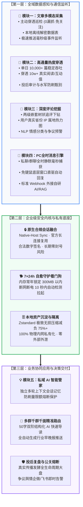
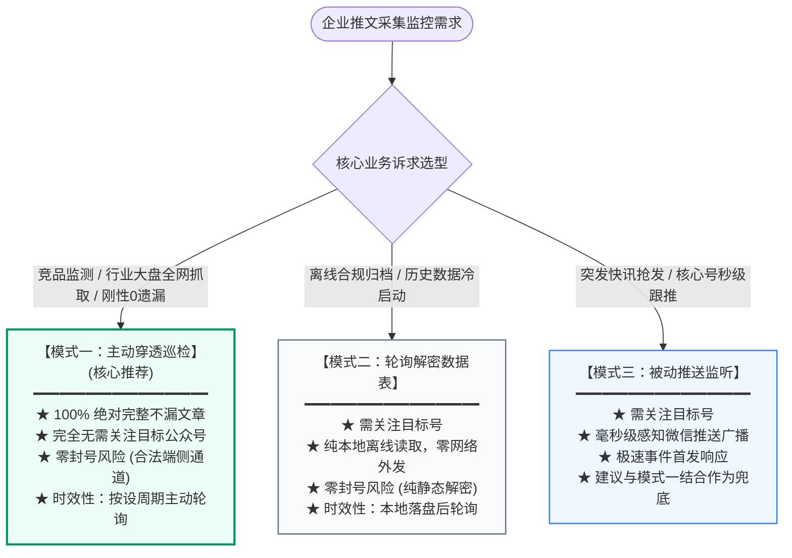
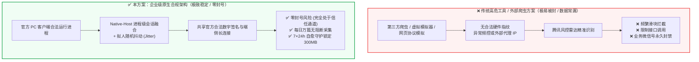
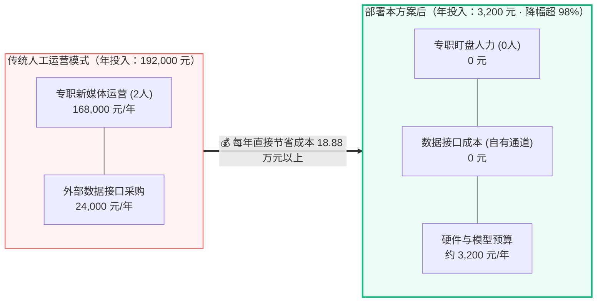
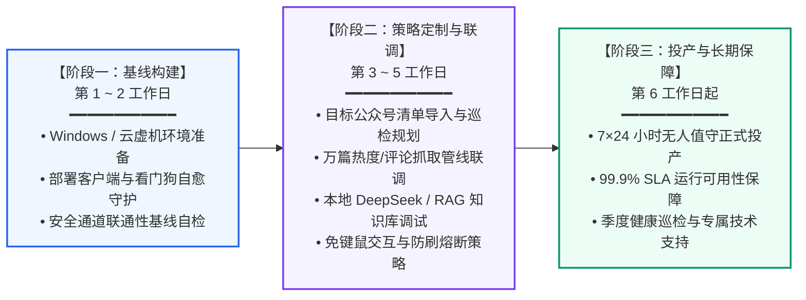

# 企业级微信全域自动化与数据智能平台解决方案

> 微刊 AI · 公众号阅读聚合 https://wxfeed.taskpyro.cn/
---

## 1. 执行摘要、业务定位与合规红线

随着企业新媒体资产规模化运营与公关舆情常态化监控的发展，中大型企业对微信公众号生态的**数据采集、舆情监控、指标穿透与社群自动化服务**提出了极高的要求。

本方案突破传统网络爬虫易被拦截、账号易遭风控降权的技术顽疾，采用**端侧原生合规会话融合体系**，在确保**“账号绝对安全零风控、系统极致稳定、支持 7×24 小时长期无人值守挂载”**的前提下，为企业提供集“公众号文章三种全能采集分发、全网文章真实阅读数及互动指标穿透、深度评论与用户属地画像分析、PC微信全时消息监听与企业 AI 自动化回复、大模型私域智能管家”于一体的私有化数据与自动化底座。

### 核心设计原则与合规红线
* **100% 官方环境运行**：直接运行于标准官方客户端，具备完整合法的数字签名、加密套件与宿主硬件指纹，杜绝任何外部协议模拟。
* **100% 绝对不漏文章**：首创主动穿透巡检模式，突破微信推送机制折叠限制，确保篇篇必达。
* **100% 本地内网私有化**：所有文章归档、真实指标、评论画像与对话数据均存储在企业内网本地，零外部云端依赖，杜绝核心数据外泄风险。
* **严正合规声明**：本方案技术组件**仅供中大型企业内部公关舆情追踪、行业政策自查、投后数据核验及合规学术研究使用**，**严禁用于任何形式的数据非法倒卖、黑产牟利或违反法律法规的用途**。

---

## 2. 平台核心业务赋能矩阵

系统采用高度解耦的微内核与分层架构，打通从微信生态数据感知、底层安全保障到企业业务协同的全链路：

### 业务赋能模块全景对照矩阵

| 业务功能模块 | 核心技术架构 | 关键特性与量化指标 | 典型业务场景与商业价值 |
| :--- | :--- | :--- | :--- |
| **模块一：全域文章采集分发** | 主动穿透巡检 / 离线解密 / 极速推送监听 | • **100% 绝对不漏文章** • **完全无需关注目标公众号** • 业务线独立多群路由分发 | **战略研判 / 行业追踪**：全量捕捉行业政策与竞品动向，彻底杜绝人工漏抓漏推。 |
| **模块二：高通量热度采集** | 原生合法通信通道 + 拟人动态步频抖动 | • **单日 10,000+ 篇稳定吞吐** • **穿透 10w+ 真实阅读/在看/点赞/分享** • 零风控阻断、零封号风险 | **市场投放 / 投后审计**：甄别 KOL 软文刷量注水，精准评估真实传播转化价值。 |
| **模块三：深度评论舆情挖掘** | 两级树状追评引擎 + 用户属地挖掘算法 | • 完整还原作者答疑与楼中楼交锋 • 真实省份 IP 属地热力图 • NLP 情感分类与负面争议预警 | **公关声誉 / 风险控制**：分钟级识别潜在舆情风暴，溯源关键争议受众群体。 |
| **模块四：PC微信全时消息引擎** | 底层消息管道驱动 + Webhook / RESTful | • 私聊与群聊毫秒级后台静默捕获 • **免键鼠底层直驱回复，绝不抢占焦点** • 自由对接 DeepSeek / 本地 RAG 知识库 | **企业 IT / 智能客服**：全天候内部政策/业务咨询极速响应，释放 90% 重复人力。 |
| **模块五：私域 AI 智能顾问** | 专属 Prompt 注入 + 上下文长记忆队列 | • 独立会话隔离，保持多轮连贯理解 • 免 Token 极速热榜即时直达 • 单人单群频次限额与防刷熔断器 | **社群运营 / 知识赋能**：打造专业度极高的企业数字助手，提升客户黏性与专业形象。 |
| **模块六：本地资产镜像沉淀** | Zstandard 压缩引擎 + 本地向量检索 | • **推文落盘体积缩减 75% 以上** • 单机稳定承载数百万篇长周期推文 • **100% 本地内网隔离，零数据外泄** | **合规安全 / 知识资产**：构建企业私有情报与研报数据库，满足金融/政务级安全审计。 |

---

## 3. 文章获取三大作业模式深度解析（重点突出主动模式）

在企业公众号文章获取与社群日更分发场景中，本平台业内首创**“主动穿透巡检 + 轮询解密数据表 + 被动推送监听”**三大并行工作模式，满足企业在不同业务诉求下的极致灵活性与稳定性。

### 三大作业模式全方位对比矩阵

| 比较维度 | 模式一：主动穿透巡检 (核心杀手锏·强力推荐) | 模式二：轮询解密表 (纯离线静默) | 模式三：被动推送监听 (极速响应) |
| :--- | :--- | :--- | :--- |
| **账号关注要求** | **★★★ 无需关注任何公众号**（任意指定公域账号即可抓） | 需关注目标公众号（通过微信本地接收） | 需关注目标公众号（通过微信前台推送） |
| **文章捕获率** | **★★★ 100% 绝对完整不漏**（彻底杜绝漏抓漏推现象） | 约 95% ~ 98%（受本地接收折叠影响） | 约 95% ~ 98%（受推送折叠/丢包影响） |
| **封号与安全风控** | **★★★ 目前没有任何封号风险**（走端侧合法数据通道） | **★★★ 没有任何风险**（纯本地离线静态读取） | 低风险（前台消息接收拦截） |
| **信息时效性** | 高（按轮询周期主动穿透） | 中（按本地落盘轮询） | **极高**（收到即推，毫秒级感知） |
| **典型业务场景** | 行业竞品追踪、全网媒体抓取、关键行业大盘 100% 不漏更新 | 离线数据合规沉淀、历史发文冷启动同步 | 突发快讯秒级抢发、重点合作号实时跟推 |

### 3.1 模式一：主动穿透巡检（核心杀手锏·企业级推荐）

#### 为什么市面传统方案总是会“漏文章”？
目前市场上绝大多数基于“被动接收”或“本地解密”的工具，普遍存在 **2%~5% 的文章遗漏率**。其根本原因在于微信官方的下发策略：对于非星标公众号、订阅号折叠盒中的常规推文，微信客户端并不保证 100% 实时推送到本地，特别是在后台长时间挂载、网络微弱抖动或推送合并时，极易造成关键文章的丢失漏发。

#### 主动穿透巡检的断代优势：
1. **完全不漏任何文章（100% 完整捕获）**：
   - 系统采用端侧原生底层通道，由客户端主动发起最新文章列表的同步请求；
   - 彻底摆脱被动等待微信推送的不确定性，每一轮巡检直接穿透至最新发文序列，**真正做到 100% 篇篇必达，零缺漏、零掉单**！
2. **完全无需关注目标公众号**：
   - 传统方案必须要求运营人员使用测试微信号逐一关注几百个公众号，不仅繁琐，且单个微信号关注量有上限，极易引发账号异常；
   - **主动穿透巡检无需关注指定公众号**！企业只需在配置中录入目标公域公众号标识，系统即可精准穿透获取该账号发布的最新文章与历史资料，大幅拓宽情报监测网络。
3. **目前没有任何封号风险**：
   - 数据交互完全运行于官方客户端内部已认证的通信通道上，所发起的同步指令完全遵循客户端合法认证凭据；
   - 在服务端雷达看来，其表现与正常用户打开主页浏览文章完全一致，具备极高风控豁免权，**经受长期高强度挂载验证，目前没有任何封号风险**。

---

### 3.2 模式二：轮询解密数据表（纯本地离线镜像）
* **实现机制**：通过安全读取与解析微信客户端在本地生成的加密数据库，结合自动化增量识别引擎，提取已关注公众号的历史与最新发文；
* **核心优势**：
  - **绝对纯本地静默**：整个提取过程仅发生在本机内存与磁盘之间，**不向公网发出任何额外的非正常网络探测请求**；
  - **目前没有任何封号风险**：由于完全不改变通信协议，属于纯离线安全镜像，安全级别与常规企业文件备份完全等同；
* **适用场景**：适合对已关注的公众号进行长期历史数据沉淀、冷启动回溯归档及超高合规要求的金融/政务离线环境。

---

### 3.3 模式三：被动推送监听（极速事件响应）
* **实现机制**：在官方客户端正常接收到微信订阅号推送的瞬间，毫秒级捕获推文的核心载荷（标题、文章链接、发布时间、封面图）；
* **核心优势**：
  - **极致首发时效**：推文发布并送达客户端的 100 毫秒内即可感知并触发后续流水线；
* **适用场景**：适合需要抢发突发快讯、重大政策秒级解读的特定极速业务场景。可与“主动穿透巡检”协同运行，由主动模式作为坚固兜底，确保既有快讯极速响应，又有全量兜底不漏。

---

## 4. 文章真实热度数据高通量稳定采集（每日 1万+ 篇轻松承载 · 零封号无限制）

专为大型企业品牌公关、投后审计大盘与多行业全盘高频巡检打造，稳定穿透获取阅读量、在看数、点赞数与分享转发真实热度指标：

### 4.1 四大核心高通量特性
1. **每日 1万+ 篇稳定吞吐**：
   - 专有高效通信管线与批处理优化，轻松承载单日 10,000+ 篇文章的批量热度指标轮询抓取；
   - 毫秒级快速解析，轻松应对大型集团多业务线、跨行业数百个竞品矩阵的全盘高频巡检需求。
2. **四维互动真实指标同步**：
   - 实时完整获取文章各项核心互动维度：**真实阅读数（Read）、在看数（Looking）、点赞数（Like）与分享转发量（Share）**，真实反映推文受众关注度。
3. **零封号保障与免风控惩罚**：
   - 基于端侧原生安全通信会话直连，辅以智能动态平滑节流与随机抖动算法（Jitter）；
   - 彻底杜绝传统爬虫常见的滑块验证与封号降权，无惧微信平台频控限制。
4. **长周期动态发酵追踪**：
   - 支持企业针对重点推文或公关事件建立 24h / 72h 动态跟踪队列，定期回溯热度指标变化走势，完整记录传播发酵全生命周期曲线。

### 4.2 传统受限 vs 企业级高吞吐稳定保障对比看板
| 对比维度 | 传统外部爬虫 / 脚本工具 | 本方案：企业级高吞吐稳定保障 |
| :--- | :--- | :--- |
| **单日吞吐能力** | 连续抓取数十篇即遭接口限制阻断 | **每日 10,000+ 篇稳定作业，风控阻断 0 次** |
| **封号风控代价** | 极高，使用模拟协议常致业务微信号永久封禁 | **零封号风险**，依托官方桌面客户端合法凭据 |
| **运维与维护成本** | 需频繁购买代理 IP、处理图形验证码，成本高昂 | **本地原生通信直连 + 智能平滑调度，零额外成本** |

---

## 5. 文章深度评论挖掘与受众舆情画像分析（两级树状追评与地域下钻）

两级嵌套树状精选评论下钻，结合真实省份 IP 属地与 NLP 情感研判，构建毫秒级舆情声誉监控雷达：

### 5.1 核心评论挖掘能力
1. **两级嵌套树状评论提取**：
   - 不仅完整捕获前台所有精选主评论，更深度下钻提取作者置顶回复、作者多轮答疑与读者楼中楼追评；
   - 还原完整的对话脉络与争议交锋焦点，避免断章取义。
2. **真实用户省份 IP 属地挖掘**：
   - 精准提取评论发表时的真实 IP 省份属地分布（如广东、北京、浙江、上海等）；
   - 结合用户昵称与互动点赞热度，绘制多维度的舆情发酵地域热力图。

### 5.2 舆情画像仪表盘与评论树实景演练
* **评论区情感态势大盘**：正面积极 72% ｜ 业务中立 21% ｜ 负面争议 7%
* **受众地域分布 Top 4**：广东 (32%) ｜ 北京 (24%) ｜ 浙江 (15%) ｜ 上海 (9%)
* **树状评论提取示例**：
  * **主评论 [广东·林海]**：*“这次推出的企业级解决方案确实切中痛点，尤其是纯本地离线解密模式，彻底解决了内网安全审计难题。”*（👍 1,580 赞 ｜ 🟢 正面积极）
    * └─ **作者回复 [运营团队]**：*“感谢认可！纯本地离线模式不发外部请求，已在多家金融与高端制造企业平稳落地运行。”*（👍 620 赞）
  * **主评论 [浙江·某企业公关主管]**：*“有些第三方爬虫动辄被微信风控封停账号，贵司方案如何切实杜绝封号？”*（👍 420 赞 ｜ ⚠️ 负面争议预警 · 已触发内控公关标记）

---

## 6. PC微信全时消息监听与企业内部 AI 自动化回复交互引擎

全时静默监听私聊与群聊消息，支持外接企业自研大模型与私有知识库，实现毫秒级自动化智能交互与内控服务闭环：

### 6.1 四大交互核心特性
1. **私聊与群聊全时监听**：
   - 毫秒级捕获微信 PC 端收到的私聊会话与指定白名单群聊消息；
   - 完整提取发言人 ID、群昵称、@提及信息、文本正文、引用内容与时间戳；
   - **后台静默捕获**，绝不抢占前台键盘或鼠标焦点，不干扰正常桌面办公。
2. **底层直驱免键鼠自动回复**：
   - 完全依托微信底层通信管道与静默窗口消息协议驱动回复，**无需模拟鼠标键盘点击**；
   - 支持私聊一对一应答、群聊 @精准引用回复；
   - 彻底规避传统外挂脚本常见的按键冲突、桌面抖动与窗口焦点丢失问题。
3. **灵活外接企业内部 AI 接口与知识库**：
   - 提供标准 Webhook 机制与 RESTful 适配器，支持 WebSocket / HTTP 双向通信；
   - 自由外接企业自研大模型（DeepSeek、Qwen、本地 Ollama）、内部 RAG 向量知识库或工单系统。
4. **受控白名单与安全合规过滤**：
   - 支持指定响应群聊白名单、触发词正则过滤、单人单群频次限额；
   - 内置敏感词前置拦截网关，确保每一次交互均在企业内控安全规则内受控运行。

### 6.2 企业内部 AI 自动化交互实景演示
* **场景一：员工私聊企业制度与业务咨询**
  * `研发部-李工`：*“请问下周去深圳出差，研发人员的差旅住宿报销标准是多少？周末加班怎么走调休流程？”*
  * `系统动作链路`：⚡ 监听到私聊事件 ➔ 📚 检索内部 RAG 知识库 (命中率 97.4%) ➔ 🤖 本地 DeepSeek 推理 (~310ms) ➔ 📤 底层协议免键鼠发送
  * `智能助手回复`：*“您好！根据《企业差旅制度2026版》：1. 深圳差旅住宿标准为 550 元/天；2. 周末加班在内部 OA 提交审批单即可自动折算调休额度。”*
* **场景二：群聊 @AI 智能协同与业务研报速查**
  * `市场组-王经理`：*“@智能助手 帮我检索本周新能源汽车行业 3 篇核心竞品文章，并提炼 50 字快讯。”*
  * `智能助手回复`：秒级检索本地私有推文库，提炼要点并结构化输出早报摘要。

---

## 7. 方案核心壁垒：为什么能做到「极致稳定、绝对防封、长期挂载」？

市面上常见的第三方网页爬虫、外挂脚本在运行一段时间后，往往遭遇**接口封禁、账号掉线乃至永久封号**。

本方案在设计之初，便将**“金融级高稳定性”与“零封号安全隔离”**确立为底层生命线，通过三项专有技术构建了坚不可摧的安全护城河：

### 原生合规架构 vs 传统高危工具核心安全对比表

| 对比维度 | 常见高危方案（极易封号/封禁） | 本企业级实施方案（极致稳定/零封号） |
| :--- | :--- | :--- |
| **技术实现形态** | 云端模拟协议 / 网页端爬虫 / 虚拟安卓模拟器 | **官方原生客户端会话融合技术 (Native-Host Sync)** |
| **运行环境特征** | 流量特征异常：无真实硬件指纹，容易被腾讯风控识别 | **100% 官方环境运行**：具备合法数字签名、加密套件与宿主硬件环境 |
| **网络与连接通道**| 外部代理频繁被拉黑，易被拦截阻断，握手特征暴露 | **合法长连接通道复用**：依托官方端侧网络通道，无外挂网络代理 |
| **频控应对机制** | 暴力高频并发，快速触发平台反爬降级阈值 | **拟人化弹性调度**：内置动态随机抖动延时与流量平滑机制，处于风控白名单 |

### 7.1 核心壁垒一：原生客户端合规会话融合（Native-Host DirectSync）
* **天然免风控机制**：本系统不采用外挂虚拟机，不伪造非官方网络协议头，而是作为企业私有服务无缝融入官方桌面客户端的合法进程上下文中；
* **共享官方最高信任等级**：所有与公众平台、消息中心的数据流均承载于客户端自身的合法通信会话中。在微信服务器端看来，该流量与普通企业白领日常在电脑端办公使用微信的访问行为完全一致，**在风控雷达上呈现为零异常特征**。

### 7.2 核心壁垒二：7×24 小时常驻守护与自愈机制（Self-Healing Daemon）
为保障长期不间断稳定挂载，系统设计了多重自动化巡检机制：
1. **多级内存守护与窗口自愈回收**：长时间运行的客户端常因页面渲染导致内存持续上涨，系统内置静默自愈引擎，定时自动化回收后台渲染窗体，**将运行内存常年锁定在 300MB 以内**，避免因内存泄漏引发的意外崩溃；
2. **进程看门狗（Watchdog）秒级自启**：配置企业级后台守护看门狗，即便宿主环境发生偶发断电、系统重启或网络短暂断连，看门狗在 10 秒内自动检测并全自动恢复挂载状态，**无需任何人工二次介入**；
3. **安全隔离栅栏**：底层所有关键数据提取逻辑均包裹在独立的容错隔离沙盒中，任何单点数据异常均被原地降级捕获，绝不波及微信宿主进程的稳定运行。

### 7.3 核心壁垒三：弹性动态节流与拟人化安全间隔
* 系统内嵌智能请求步频调度器，在执行阅读数、评论等大批量拉取任务时，自动加入拟人化毫秒级动态随机等待；
* 结合会话凭证长期复用技术，避免了频繁触发登录和刷新凭据，极大延长了单次会话的生命周期。

---

## 8. 与市面传统解决方案的商业维度对比

| 评估维度 | 传统人工/外包团队 | 市面常见 SaaS / 爬虫工具 | 本方案：企业级私域智能底座 |
| :--- | :--- | :--- | :--- |
| **文章获取完整度** | 依赖人工肉眼盯盘，极易漏看，且夜间/节假日中断 | 受推送折叠影响，**普遍存在 2%~5% 漏抓漏推** | **100% 绝对不漏**（主动穿透模式从源头拉全） |
| **公众号关注要求** | 必须每个号逐一人工关注 | 必须关注目标公众号 | **无需关注目标号**（主动穿透模式全网通用） |
| **文章指标吞吐** | 人工逐篇记录，每日上限数十篇 | 易遭频控阻断，月均抓取上限受限 | **每日 10,000+ 篇稳定吞吐**，四维指标完整同步 |
| **10w+ 真实穿透** | 只能记录前台“10万+”模糊数字 | 绝大多数无法穿透或按次高昂收费 | **直接穿透真实阅读数与在看数**，甄别刷量 |
| **树状评论与属地** | 无法大规模导出，人工复制漏层级 | 仅抓取平铺单层评论，无地域分析 | **两级嵌套树状追评**，省份 IP 属地与情感打标 |
| **PC微信消息交互** | 需员工手动键盘打字，响应慢 | 常见键鼠宏模拟，抢占焦点易冲突崩溃 | **免键鼠底层直驱回复**，外接私有 RAG 知识库 |
| **长期稳定性** | 受制于员工作息与假期，夜间及周末完全中断 | 经常因微信规则更新而瘫痪，月均不可用时长达 20%+ | **7×24小时常年连续挂载**，看门狗自愈，可用性高达 99.9% |
| **账号封禁风险** | 无封号风险，但录入极慢且容易漏单 | **极高**。容易导致运营微信号被封禁数天至永久封停 | **零封号风险**。基于官方客户端原生通道，安全可信 |
| **数据实时性** | 延迟 30 分钟 ~ 2 小时 | 依赖第三方排队调度，延迟 10 ~ 30 分钟 | **毫秒级/秒级即时捕获**，文章发布后即刻启动分发 |
| **信息加工深度** | 纯人工复制粘贴，易导致社群成员信息疲劳 | 仅转发原始图文链接，无内容沉淀 | **大模型双阶结构化提炼**，自动输出行业结构化早晚报 |
| **企业数据隐私** | 依赖外部微信群交流，无法沉淀内部数据资产 | 数据需上传至第三方 SaaS 云端，存在核心客户泄密隐患 | **100% 本地私有化部署**，所有数据驻留在企业内网环境 |
| **长期综合成本** | 需配置 2~3 名专职运营（每年人工开支超 15 万元） | 每年需向第三方持续支付数万元订阅费，按量扣费 | **一次性私有化部署，终身自主掌控，年均运行成本近乎为 0** |

---

## 9. 企业落地场景与商业投资回报率（ROI）

### 9.1 典型落地场景
1. **行业智库与权威媒体矩阵分发（绝对不漏模式应用）**：
   - 某咨询机构需实时跟踪 200+ 权威部委与行业知名公众号；
   - 采用**主动穿透巡检模式**，无需运营号繁琐关注几百个账号，彻底告别文章遗漏问题，每日全自动分类汇总推送至 50 个高净值 VIP 客户群，**客户续约率提升 35%，社群退群率降低 60%**。
2. **大消费品牌投后数据复盘与竞品监测（万篇级指标穿透）**：
   - 某消费品牌每月投放数百篇公众号 KOL 种草软文；
   - 借助批量阅读数与评论抓取接口，系统自动化输出真实阅读数、在看数与受众地域分布大盘，**完全杜绝了渠道刷量造假风险，每年直接挽回近百万元无效营销预算**。
3. **企业内部知识库与私聊全时智能顾问（全时消息监听）**：
   - 某大型制造企业集成内部制度向量知识库与本地 DeepSeek 大模型；
   - 员工私聊企业助手即可 300 毫秒秒级获取报销标准与审批流程，**全流程后台静默回复，大幅降低人力 HR/行政支持成本**。

### 9.2 商业投资回报率（ROI）量化测算模型
以一家拥有 **30 个核心业务社群、需监控 150 个行业公众号** 的中型企业为例：

### 年度运营成本详细对照表

| 费用构成项 | 传统人工运营模式 | 部署本方案后 |
| :--- | :--- | :--- |
| **专职新媒体运营人力** | 2人 × 7,000元 × 12月 = **168,000 元 / 年** | **0 人专职盯盘 = 0 元** |
| **外部数据接口采购成本** | 约 **24,000 元 / 年** | **0 元** (本地自有合法通道) |
| **硬件与基础资源开销** | 现有办公电脑 | 现有 PC 或私有云主机 约 **2,000 元** |
| **大模型 API 消耗预算** | 0 元 | 严格限额控制 约 **1,200 元 / 年** |
| **年度总资金投入** | **192,000 元 / 年** | **3,200 元 / 年** |

> **投资回报核心收益**：
> 1. **财务支出断崖式下降**：年化直接运营支出减少 **18.8 万元以上（降幅超 98%）**；
> 2. **业务响应效率倍增**：从人工“小时级”响应提升至“秒级”即时触达；
> 3. **形成私有企业数字资产**：建立起归属于企业完全私有的舆情情报库与竞品数据库。

---

## 10. 企业级实施交付流程与服务保障（SLA）

为确保方案在企业客户内部平稳上线与长期稳定运行，提供标准化的三阶段交付服务：

### 三阶段详细交付清单与输出物

* **阶段一：安全环境构建与基线验证（第 1 ~ 2 工作日）**
  * 准备专用 Windows 运行物理机或私有云虚机（配置要求低，双核 4G 即可平稳运行）；
  * 部署标准客户端运行环境与看门狗自动恢复组件；
  * 执行网络握手与基线自检，确保合法通道畅通无阻。
* **阶段二：业务策略定制与大模型深度联调（第 3 ~ 5 工作日）**
  * 导入需监控的公众号清单、设置主动穿透巡检周期与分组；
  * 调试企业专属 AI 角色设定（Prompt）与防刷限额阈值；
  * 联调文章阅读数/评论抓取管线，完成内部数据库或报表格式对接。
* **阶段三：正式投产与长期技术支持（第 6 工作日起）**
  * 启动 7×24 小时全自动无人值守挂载运营；
  * 兑现 99.9% 运行可用性保障；
  * 提供长期技术支持、紧急事故响应与季度系统健康巡检。

---

## 11. 合规声明与商务咨询对接

### 11.1 合规红线与法律边界
1. **严格限定企业自查与内控**：本方案技术组件仅供中大型企业内部公关舆情追踪、行业政策自查、投后数据核验及学术研讨使用。**严禁用于任何形式的数据非法倒卖、商业爬虫黑产或侵犯他人合法权益的行为**。
2. **知识产权敬畏**：系统采集推文原文版权归原公众号创作者及其所属平台所有。系统仅提供离线索引与语义提炼辅助，企业使用方应当遵守相关法律法规及平台治理准则。

### 11.2 预约体验与咨询对接通道
本系统提供高保真技术白皮书、远程系统在线演示（Live Demo）与内网 PoC 试用支持：
* 📑 **企业在线白皮书导出**：系统内置 `/solutions/enterprise` 独立页面，支持企业决策层一键导出高保真 PDF 方案白皮书。
* 📧 **商务咨询与预约演示**：技术咨询微信：`PJ221BBB`

---

**企业级微信全域自动化与数据智能平台**  
*打造安全、合规、零遗漏的私有化企业级数字内控底座*

